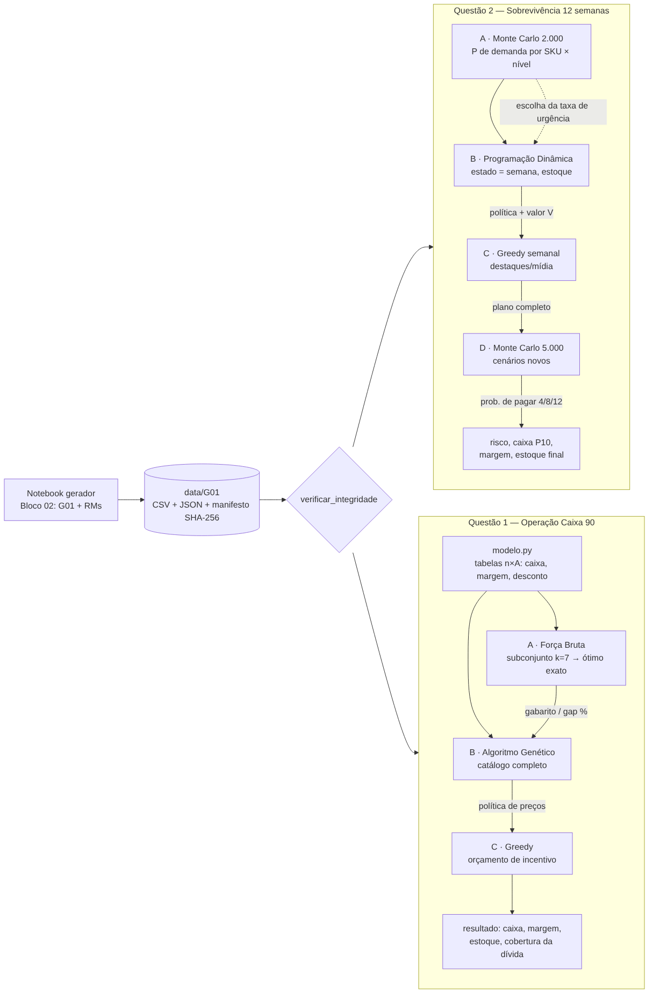

# Checkpoint 6 — Recuperação financeira de varejistas por precificação online

FIAP · Dynamic Programming · Prof. André Marques

## Grupo

**Grupo: G01** *(código provisório — ver observação abaixo)*

| Integrante | RA |
| Felipe Bicaletto | RM563524 |
| Mauro Carlos | RM556645 |
| Antonio Neto | RM561777 |

- **Seed base:** 16 (4 + 5 + 7)
- **Seed final:** 1016 (1000 × 1 + 16)
- **ID da instância:** `29b470fd0b1c`

> **Observação:** o código do grupo usado foi G01, porque o número oficial ainda não havia sido
> definido. Se o professor atribuir outro código, basta alterar `GRUPO` no Bloco 02 do notebook
> `gerador/Gerador_Inputs_Checkpoint_6.ipynb`, executar o notebook e copiar a pasta gerada
> (`dados_gerados/GXX`) para `data/GXX`. Depois, rode os scripts com `--grupo GXX`.

## Como executar

Requer Python ≥ 3.10 (desenvolvido e testado com 3.13).

```bash
pip install -r requirements.txt

python questao_01/main.py                 # Q1 completa (≈ 3 s)
python questao_02/main.py                 # Q2 completa, 2.000 + 5.000 cenários (≈ 3 s)
python -m pytest                          # 38 testes automatizados

python questao_01/benchmark.py            # tempo/memória por tamanho + otimização antes/depois
python questao_02/benchmark.py
```

Os dois `main.py` aceitam `--seed`, `--grupo` e `--dados`, e `--help` lista todas as opções.
Exemplos do enunciado:

```bash
python questao_01/main.py --seed 14 --modo completo
python questao_02/main.py --seed 14 --cenarios 5000
```

### Cenário-surpresa (sem alterar código)

| Alteração | Q1 | Q2 |
|---|---|---|
| Meta de caixa +10% | `--meta-fator 1.10` | — |
| Concorrente reduz preço em 8% | — | `--concorrente-fator 0.92` |
| Custo logístico +15% | `--frete-fator 1.15` | `--frete-fator 1.15` |
| Orçamento promocional −25% | `--orcamento-fator 0.75` | `--orcamento-fator 0.75` |
| SKU indisponível | `--remover-sku Q1-012` | `--remover-sku Q2-003` |
| População / mutação do GA | `--populacao 50 --mutacao 0.05` | — |
| Outros | `--fracao-desconto`, `--subconjunto`, `--geracoes` | `--divida-fator`, `--estoque-fator`, `--max-skus`, `--cenarios-construcao` |

Use `--saida <pasta>` para não sobrescrever os resultados oficiais. Exemplos já executados estão em
`questao_01/resultados/cenario_surpresa/` e `questao_02/resultados/cenario_estresse/`.

## Estrutura

```
avaliacao-varejo-grupo01/
├── README.md · requirements.txt · IA_USO.md · pytest.ini
├── gerador/Gerador_Inputs_Checkpoint_6.ipynb   notebook oficial (só o Bloco 02 foi preenchido)
├── data/G01/                                   instância oficial: 2 CSV + 2 JSON + manifesto_dados.json
├── comum/        dados.py (leitura + verificação SHA-256) · medicao.py (perf_counter + tracemalloc)
├── questao_01/   modelo · brute_force · genetic_algorithm · greedy · main · benchmark · parametros.json
├── questao_02/   modelo · monte_carlo · dynamic_programming · greedy · main · benchmark · parametros.json
├── tests/        test_dados · test_questao_01 · test_questao_02
└── docs/         arquitetura.png · complexidade.md · desempenho.md · decisoes.md
```

A instância fica em `data/G01/` com os nomes gerados pelo notebook (`q1_catalogo_G01.csv` etc.),
em vez de um único `instancia_grupoXX.csv`, para que os hashes do manifesto continuem válidos.



---

## Questão 1 — Operação Caixa 90

**Nesta questão utilizamos 3 algoritmos.** A **Força Bruta** resolve exatamente um subconjunto
de 7 SKUs (288.000 combinações) e serve de gabarito para o **Algoritmo Genético**. O GA, validado
contra esse gabarito, gera a política de preços dos 30 SKUs. Essa política entra no **Greedy**,
que distribui o orçamento de incentivo (cupom/cashback/frete) para os SKUs com maior caixa ganho
por real investido.

### Resultados (instância oficial, seed 1016)

| Indicador | Valor | Origem |
|---|---|---|
| Caixa no preço atual (status quo) | R$ 491.563 | `resumo.json → status_quo_preco_atual` |
| Força Bruta, subconjunto de 7 SKUs | R$ 351.998 (ótimo exato) | `brute_force.forca_bruta` → `bf_vs_ga_subconjunto.csv` |
| GA no subconjunto, gap médio | B: 0,00% · A: 0,10% | `genetic_algorithm.executar_ga` → `bf_vs_ga_subconjunto.csv` |
| GA no catálogo completo | R$ 644.083 (gap 0% vs. ótimo exato) | `ga_configuracoes.csv`, `fitness_ga.png` |
| Caixa após o Greedy | **R$ 677.524** | `greedy.alocar_incentivos` → `greedy_antes_depois.csv` |
| Orçamento de incentivo usado | R$ 70.624 de R$ 70.679 (99,9%) | `resumo.json → resultado_final` |
| Meta de caixa 90d | R$ 417.835 → **atingida, folga de R$ 259.689** | idem |
| Cobertura da dívida (R$ 430.978) | **157%** | idem |
| Margem | 24,4% (mínimo exigido: 5,05%) | idem |
| Estoque remanescente | 1.213 un. (R$ 676 mil a custo) | idem |

Política resultante: preço no teto da grade (1,10) em 27 SKUs e venda pausada em 3, que não
atingem a margem mínima em nenhum nível (`politica_precos_ga.csv`). Com demanda pouco elástica,
subir o preço gera mais caixa do que dar desconto. O Greedy recupera giro (+302 unidades vendidas)
usando a verba de incentivo. Discussão completa em [docs/decisoes.md](docs/decisoes.md).

### Evidências exigidas

| Evidência | Arquivo |
|---|---|
| Tabela Força Bruta × GA | `questao_01/resultados/bf_vs_ga_subconjunto.csv` |
| Gráfico de fitness por geração | `questao_01/resultados/fitness_ga.png` |
| Tabela antes/depois do Greedy | `questao_01/resultados/greedy_antes_depois.csv` |
| Comparação de 2 configurações do GA | `questao_01/resultados/ga_configuracoes.csv` + `docs/decisoes.md` |
| Big O | `docs/complexidade.md` |
| Medições + otimização antes/depois | `docs/desempenho.md`, `questao_01/resultados/otimizacao_forca_bruta.csv` |

---

## Questão 2 — Plano de Sobrevivência em 12 Semanas

**Nesta questão utilizamos 3 algoritmos.** O **Monte Carlo** sorteia 2.000 cenários de demanda,
preço do concorrente e custo logístico e estima, para cada SKU e nível de preço, a distribuição da
demanda semanal. A **Programação Dinâmica** (estado = semana e estoque restante) usa essas
distribuições para decidir o preço de cada semana em função do estoque. O **Greedy** usa o valor
calculado pela DP para escolher, semana a semana, os até 4 SKUs que recebem destaque/mídia dentro
do orçamento. No fim, o plano completo volta ao **Monte Carlo** em 5.000 cenários novos, que medem
a probabilidade de pagar cada dívida.

### Resultados (instância oficial, 5.000 cenários de validação)

| Indicador | Preço atual fixo | DP | **DP + Greedy** | Origem |
|---|---|---|---|---|
| P(pagar semana 4 / 8 / 12) | 100% / 100% / 100% | 100% / 100% / 100% | **100% / 100% / 100%** | `monte_carlo.simular` → `validacao_comparativo.csv` |
| Caixa final médio | R$ 83.889 | R$ 239.393 | **R$ 245.022** | idem |
| Caixa final P10 (percentil de risco) | R$ 81.127 | R$ 234.933 | **R$ 240.429** | idem, `distribuicao_caixa_final.png` |
| Margem média | 18,4% | 25,6% | 25,5% | idem |
| Estoque final médio | 551 un. | 764 un. | 708 un. | idem |
| Cenários de falha | 0 | 0 | 0 | idem |

Dívidas: R$ 67.221 (sem. 4), R$ 86.827 (sem. 8), R$ 126.039 (sem. 12); caixa inicial R$ 19.451.
Taxa de urgência escolhida: 0,10 (`escolha_taxa_urgencia.csv`). O Greedy alocou 30 destaques
(`destaques_greedy.csv`). Como a instância oficial não apresenta risco, rodamos também um
**teste de estresse** (dívidas ×1,77, concorrente −8%, frete +15%). Nele, a probabilidade de pagar
tudo vai de 0% (preço fixo) para 2,9% (DP) e 44% (DP + Greedy). Ver `docs/decisoes.md`.

### Evidências exigidas

| Evidência | Arquivo |
|---|---|
| Diagrama MC → DP → Greedy → MC | `docs/arquitetura.png` |
| Distribuição do caixa final | `questao_02/resultados/distribuicao_caixa_final.png`, `validacao_comparativo.csv` |
| Trajetória semanal de preço e estoque | `questao_02/resultados/trajetorias_skus.png`, `plano_precos_semanal.csv` |
| Probabilidade de pagamento de cada compromisso | `questao_02/resultados/validacao_comparativo.csv` |
| Big O | `docs/complexidade.md` |
| Três tamanhos de entrada + otimização da DP | `docs/desempenho.md`, `questao_02/resultados/desempenho_tamanhos.csv`, `otimizacao_dp.csv` |

---

## Testes e reprodutibilidade

- `python -m pytest` executa 38 testes: casos pequenos com resposta conhecida, limites (orçamento
  zero, estoque zero, dívida zero/enorme), entradas inválidas, equivalência das versões otimizadas
  com as ingênuas, DP contra enumeração exaustiva, reprodutibilidade por seed e as duas pipelines
  de ponta a ponta.
- Todas as seeds são explícitas. A mesma seed produz os mesmos resultados.
- Versões usadas no desenvolvimento: Python 3.13, NumPy 2.5, pandas 3.0, matplotlib 3.11, pytest 9.1.
